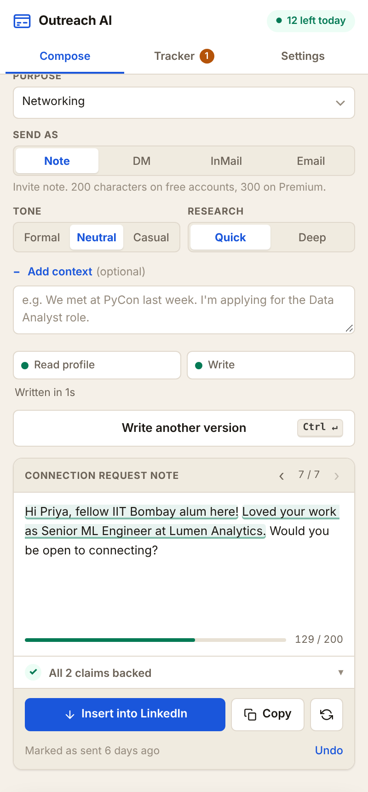

# LinkedIn Outreach AI — v4

Improvements to the Ark Abroad LinkedIn outreach extension. Same product, same server and API, same license keys.

**The headline:** AI outreach fails in two ways. It's *generic*, or it's *wrong*: a confident made-up "congrats on the promotion!" sent to a stranger under your name. v4 adds a **trust layer** that checks every claim in a message against what was actually read, before you hit Send. It also finds the real common ground between you and the person you're writing to.

<p>
  
  
  
</p>

## The trust layer

### Fact check, every sentence
After generation, each sentence is checked against the sources the extension holds:
- their profile
- Deep Mode research
- shared background
- your own bio and profile

The check pulls out *checkable claims*: names (companies, schools, events, titles), numbers, and event words (promotion, funding, talk, hiring, launch…). It then looks each one up in those sources.
- **Backed**: highlighted green inside the message, with the evidence shown. *"Their recent post: Slides from my PyData Berlin talk…"*
- **Not found**: highlighted amber, with the exact words underlined. *"Couldn't find "Director", "Google" or "promotion" in their profile or the research. Check before sending."*
- **Claims about you** ("I spoke at NeurIPS") are checked against *your* bio and profile only.
- It re-checks live as you edit.

It runs **locally, instantly, with no extra AI call**, so it costs nothing per message. It's a heuristic and labelled as one: it flags things for a human to check; it doesn't judge truth.

### Fix with AI
One click sends a revision request that lists exactly what to fix:
- the unsupported sentences
- the clichés found
- a missing question to them
- a wrong first name in the greeting

The previous draft goes along with it. The revised version is checked again. Every request now also carries a standing rule: *only state facts that appear in the data provided.*

### Common ground
**Import my LinkedIn** opens your own profile for a few seconds, reads it, and closes it. It also fills in your name and bio. Then every profile shows what you actually share:
- the same school, including acronyms ("IIT Bombay" ↔ "Indian Institute of Technology Bombay")
- the same past or current company
- the same city
- shared skills

Each item is a hook you can tick, it works in Quick mode, and it's verified from both profiles, so the fact check can back it up.

### Writing check
Flags:
- placeholders (`[Name]`)
- greeting the wrong person
- clichés ("I came across your profile")
- nothing specific about them
- no ask
- mostly about you
- a missing subject line for InMail or email

### Insights: what gets replies
Each tracked message records how it was written (common ground or not, Quick or Deep, format, tone). Once you've marked a few as sent and replied, the Tracker shows your reply rate and the strongest pattern. For example: *"Messages with common ground got 50% replies vs 33% without."*

## Everything else that changed, and why

### 1. It stopped losing work
**Before:** the UI was a popup. Clicking back on LinkedIn closed it, and a ~20-second Deep Mode run vanished along with the result.
**Now:** the background worker runs every job and records progress in `chrome.storage.session`. The UI is just a view of that state. You can close it, switch tabs or browse elsewhere, then come back to a finished message.

### 2. It lives next to LinkedIn
- **Side panel** instead of a popup. It stays open while you browse and **follows you from profile to profile**.
- **Insert into LinkedIn.** One click fills the *Add a note* box of a connection invite, or the message composer (InMail subjects included). It never presses Send; the user always does. If no box is open, it copies the message and says exactly where to click.
- **"Write outreach" button** on profile pages, a right-click menu item, and an `Alt+Shift+O` shortcut.

### 3. Messages that fit where they're going
- **Send as Note / DM / InMail / Email.** Each format has its own rules: invite notes are capped at **200 characters (free) or 300 (Premium)**, and InMail and email get a subject line.
- **Live limit meter**, plus **Trim to fit** (cuts at a sentence boundary) and **Rewrite shorter**.
- **Pick your hooks.** Deep Mode's research results show up as checkboxes. Untick one and rewrite; research doesn't re-run, so no wasted time or credits.
- **Version history.** Every regenerate is kept (‹ 2/3 ›) instead of overwriting the last one.
- **Add context** ("we met at PyCon…") per person, and **Review & edit** what was scraped before generating.
- Purpose, tone, format and mode are remembered.

### 4. A tracker, so outreach gets followed up
Recent contacts grew from 5 to a 50-person tracker:
- status per person (Drafted → Sent → Replied)
- **follow-up reminders** (Chrome notification plus a badge after N days)
- search, filters and **CSV export**

### 5. Reliability and bug fixes
| Bug in v3 | Fix |
|---|---|
| Header said "● Active" for *any* saved key, even a typo | Key is verified against `/api/validate`; the header shows real status and "N left today" |
| Deep Mode never sent your name/bio to the writer | Sent on every request |
| Contacts with an empty `profileUrl` overwrote each other | Keyed by LinkedIn slug, one entry per person |
| `res.json()` on Railway's HTML 502 pages → cryptic JSON error | Safe parse, 1 automatic retry on 5xx/network, plain-English errors (`utils/api.js`) |
| No timeouts, so requests could hang forever | Per-endpoint timeouts |
| Experience parser grouped lines in fixed chunks of 3–4, using an **India-only location regex** to decide where entries ended | Reads LinkedIn's list structure (incl. grouped roles at one company); text fallback anchors on date lines |
| Scraper jumped the page to 2400px and dumped you at the top | Scrolls only if sections are missing, then restores your exact position |
| Dead code and duplicate CSS from older versions | Removed |

### 6. Polish
First-run setup (key → about you → done), dark mode, keyboard shortcuts (`Ctrl+Enter`, `Ctrl+Shift+C`, `Alt+←/→`), toasts with undo-style actions, settings that save automatically, accessible focus states and ARIA roles, reduced-motion support.

## How it's built

```
linkedin extention/
  manifest.json      MV3 · side panel, commands, context menu, alarms, notifications
  background.js      job runner: scrape → research → write; owns all state writes
  content_script.js  scraper, insert-into-LinkedIn, floating button (Shadow DOM)
  sidepanel.html/js/css   UI, a pure view over storage (renders on storage.onChanged)
  utils/
    api.js           server client: timeouts, retries, error classification
    session.js       per-profile working state in chrome.storage.session
    formats.js       Note/DM/InMail/Email rules, the writing brief, meter, trim
    contacts.js      tracker store (migrates v3 "recentContacts" automatically)
    grounding.js     fact check: claims → evidence, sentence offsets for highlighting
    common.js        common ground: fuzzy org/school matching incl. acronyms
    lint.js          writing check (clichés, placeholders, wrong name, no ask…)
```

**No backend changes were needed.** The server's API has no notion of formats, so the requirements travel as a short written brief appended to the sender bio, which the server already gives the model. The request also carries explicit `format`, `maxChars` and `instructions` fields, ready for when the server reads them. Hook selection works by filtering `enrichmentJSON.topHooks` before it goes back to `/api/generate/deep`.

## Install

1. `chrome://extensions` → enable **Developer mode** → **Load unpacked** → choose `linkedin extention/`.
2. Click the toolbar icon (or press `Alt+Shift+O`) to open the side panel and enter your license key.

## Tests

- **`tests/unit.js`**: 36 checks on the trust layer, covering true messages with no false alarms, invented claims, sender claims, acronyms, and the lint rules.
- **`tests/e2e.js`**: 78 checks that load the real extension in Chromium against LinkedIn-like fixture pages (`tests/fixtures/`) and a mock of the Ark API (`tests/mock-server.js`). They cover:
  - onboarding and key validation
  - scraping both page layouts
  - LinkedIn swapping pages before the content updates
  - quick and deep generation
  - closing the panel mid-run
  - hook selection
  - the 200/300 limits and trimming
  - inserting into the invite note and the message box
  - tracker, follow-ups and CSV export
  - retry after a 502, and auth errors
  - importing your profile
  - common ground
  - a simulated hallucination caught, then fixed with AI
  - live re-check while editing
  - insights

```bash
node tests/unit.js
node tests/e2e.js            # needs Playwright + Chromium
SHOTS=1 node tests/e2e.js    # also regenerate docs/screenshots/
```
