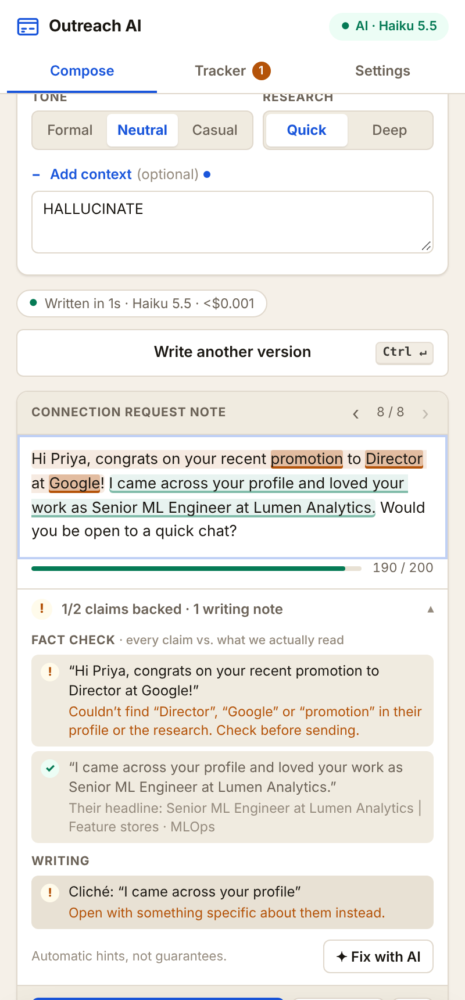
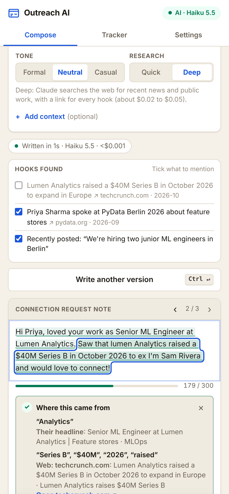
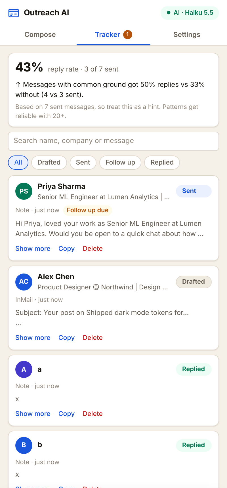

# LinkedIn Outreach AI — v4.4

Improvements to the Ark Abroad LinkedIn outreach extension, built on the latest upstream version (v3.1, 19 Nov). It needs no license key and has no company server: messages are written **free on your device**, or by **Claude with your own Anthropic API key**.

**The headline:** AI outreach fails in two ways. It's *generic*, or it's *wrong*: a confident made-up "congrats on the promotion!" sent to a stranger under your name. v4 adds a **trust layer** that checks every claim in a message against what was actually read, before you hit Send. It also finds the real common ground between you and the person you're writing to.

<p>
  
  
  
</p>

## Two ways to write, both checked

| | **Free mode** (default, no key) | **AI mode** (your Anthropic API key) |
|---|---|---|
| Writer | On-device writer (`utils/localwriter.js`) | Claude Haiku 5.5 (or Sonnet 5.5), prompt in `utils/prompts.js` |
| Deep mode | Picks hooks from their profile | Claude Sonnet 5.5 + web search: recent news, talks, launches, **each with its source link** |
| Cost | $0 | About $0.0002 per message on Haiku; a Deep run with web search is about $0.02–$0.06. Shown after every message. |
| Network | None | `api.anthropic.com` only |

Upstream's free template always opened with *"I came across your profile and was impressed by your work…"*. Our own writing check flags that as a cliché. It also ignored LinkedIn's 200/300-character note limit and produced the same text every time. The new free writer:
- uses only facts from the profile, so it passes the fact check by construction (unit-tested across 384 combinations of purpose, tone, format and version)
- leads with the most specific opener available: shared background, then their post, then their role
- always fits the limit
- rotates openers, so "Write another version" gives a real alternative

In AI mode, if Claude can't be used (a bad key, no credit, an outage), the error comes with a **"Write in free mode"** button, so the user is never stuck.

## Messages that fit who they're for

A message can be well written and still wrong for the person. Asking a student about "roles on your team" is the classic case. `utils/recipient.js` classifies the recipient from their title and headline (student, recruiter, team lead or manager, founder, senior engineer, professional) and shows it as a chip with the reason.
- The default purpose, **Auto**, picks what that person can realistically help with.
- If you pick something that doesn't fit, you get a one-click suggestion instead of a silent override.
- Both writers adapt the opener and the ask; in AI mode the prompt says who the recipient is.

## The trust layer

### Fact check, every sentence
After generation, each sentence is checked against the sources the extension holds:
- their profile
- Deep Mode research
- shared background
- your own bio and profile

The check pulls out *checkable claims*: names (companies, schools, events, titles), numbers, and event words (promotion, funding, talk, hiring, launch…). It then looks each one up in those sources.
- **Backed**: highlighted green inside the message, with the evidence shown. *"Their recent post: Slides from my PyData Berlin talk…"*
- **Not found**: highlighted amber, with the exact words underlined. *"Couldn't find "Director", "Google" or "promotion" in their profile or the research. Check before sending."*
- **Claims about you** ("I spoke at NeurIPS") are checked against *your* bio and profile only.
- It re-checks live as you edit.

- **Click any highlighted sentence** to see where it came from: the exact profile field, post, or web article (with a link), or what couldn't be found.

It runs **locally, instantly, with no extra AI call**, so it costs nothing per message. It's a heuristic and labelled as one: it flags things for a human to check; it doesn't judge truth.

### Fix with AI
One click sends a revision request that lists exactly what to fix:
- the unsupported sentences
- the clichés found
- a missing question to them
- a wrong first name in the greeting

The previous draft goes along with it. The revised version is checked again. The system prompt also forbids inventing facts, and web research keeps a hook only if its URL actually appeared in the search results. A made-up link is dropped before the user ever sees it.

### Common ground
**Import my LinkedIn** opens your own profile for a few seconds, reads it, and closes it. It also fills in your name and bio. Then every profile shows what you actually share:
- the same school, including acronyms ("IIT Bombay" ↔ "Indian Institute of Technology Bombay")
- the same past or current company
- the same city
- shared skills

Each item is a hook you can tick, it works in Quick mode, and it's verified from both profiles, so the fact check can back it up.

### Writing check
Flags:
- placeholders (`[Name]`)
- greeting the wrong person
- clichés ("I came across your profile")
- nothing specific about them
- no ask
- mostly about you
- a missing subject line for InMail or email

### Insights: what gets replies
Each tracked message records how it was written (common ground or not, Quick or Deep, format, tone). Once you've marked a few as sent and replied, the Tracker shows your reply rate and the strongest pattern. For example: *"Messages with common ground got 50% replies vs 33% without."*

## Everything else that changed, and why

### 1. It stopped losing work
**Before:** the UI was a popup. Clicking back on LinkedIn closed it, and a ~20-second Deep Mode run vanished along with the result.
**Now:** the background worker runs every job and records progress in `chrome.storage.session`. The UI is just a view of that state. You can close it, switch tabs or browse elsewhere, then come back to a finished message.

### 2. It lives next to LinkedIn
- **Side panel** instead of a popup. It stays open while you browse and **follows you from profile to profile**.
- **Insert into LinkedIn.** One click fills the *Add a note* box of a connection invite, or the message composer (InMail subjects included). It never presses Send; the user always does. If no box is open, it copies the message and says exactly where to click.
- **"Write outreach" button** on profile pages, a right-click menu item, and an `Alt+Shift+O` shortcut.

### 3. Messages that fit where they're going
- **Send as Note / DM / InMail / Email.** Each format has its own rules: invite notes are capped at **200 characters (free) or 300 (Premium)**, and InMail and email get a subject line.
- **Live limit meter**, plus **Trim to fit** (cuts at a sentence boundary) and **Rewrite shorter**.
- **Pick your hooks.** Deep Mode's research results show up as checkboxes. Untick one and rewrite; research doesn't re-run, so no wasted time or credits.
- **Version history.** Every regenerate is kept (‹ 2/3 ›) instead of overwriting the last one.
- **Add context** ("we met at PyCon…") per person, and **Review & edit** what was scraped before generating.
- Purpose, tone, format and mode are remembered.

### 4. A tracker, so outreach gets followed up
Recent contacts grew from 5 to a 50-person tracker:
- status per person (Drafted → Sent → Replied)
- **follow-up reminders** (Chrome notification plus a badge after N days)
- search, filters and **CSV export**

### 5. Reliability and bug fixes
| Bug in v3 | Fix |
|---|---|
| Header said "● Active" for *any* saved key, even a typo | v3.1 dropped license keys; the optional API key is **tested** before it's saved, and the header shows Free mode / AI · model / Key problem |
| v3.1 AI path: `max_tokens: 400` with a model that thinks by default, so replies could be cut off or empty; `res.json()` with no retries | `max_tokens` 8000 at `effort: low`, `stop_reason` handled (refusal, max_tokens), retries for 429/529/5xx respecting `retry-after`, plain-English errors (`utils/api.js`) |
| Scraper treated the top experience entry as the current job even when it had ended | Only "Present" (or undated) counts as current; otherwise the headline wins |
| Deep Mode never sent your name/bio to the writer | Sent on every request |
| Contacts with an empty `profileUrl` overwrote each other | Keyed by LinkedIn slug, one entry per person |
| No timeouts, so requests could hang forever | Per-endpoint timeouts |
| Experience parser grouped lines in fixed chunks of 3–4, using an **India-only location regex** to decide where entries ended | Reads LinkedIn's list structure (incl. grouped roles at one company); text fallback anchors on date lines |
| Scraper jumped the page to 2400px and dumped you at the top | Scrolls only if sections are missing, then restores your exact position |
| Dead code and duplicate CSS from older versions | Removed |

### 6. Polish
First-run setup (free or your API key → about you → done), dark mode, keyboard shortcuts (`Ctrl+Enter`, `Ctrl+Shift+C`, `Alt+←/→`), toasts with undo-style actions, settings that save automatically, accessible focus states and ARIA roles, reduced-motion support.

## How it's built

```
linkedin extention/
  manifest.json      MV3 · side panel, commands, context menu, alarms, notifications
  background.js      job runner: scrape → research → write; owns all state writes
  content_script.js  scraper, insert-into-LinkedIn, floating button (Shadow DOM)
  sidepanel.html/js/css   UI, a pure view over storage (renders on storage.onChanged)
  utils/
    api.js           Claude Messages API client: timeouts, retries, errors, cost
    prompts.js       writer + web-research prompts; keeps only hooks with real sources
    localwriter.js   free on-device writer and profile hooks
    session.js       per-profile working state in chrome.storage.session
    formats.js       Note/DM/InMail/Email rules, the writing brief, meter, trim
    contacts.js      tracker store (migrates v3 "recentContacts" automatically)
    grounding.js     fact check: claims → evidence, sentence offsets for highlighting
    common.js        common ground: fuzzy org/school matching incl. acronyms
    lint.js          writing check (clichés, placeholders, wrong name, no ask…)
```

**Calling Claude from the extension.** Following upstream, requests go straight from the service worker to `POST /v1/messages` with `fetch` and the `anthropic-dangerous-direct-browser-access` header, because the extension ships unbundled. The key is the user's own, stored in `chrome.storage.local`, and sent only to `api.anthropic.com`.
- **Writer request:** the full context goes in as JSON inside `<context>` tags (recipient, research hooks with sources, shared background, sender, resume as a PDF document block). The per-request rules go in `<requirements>` (format, hard limit, revision instructions).
- **Research request:** uses the `web_search_20260209` server tool on Claude Sonnet 5.5. `pause_turn` is resumed, and server-side refusal fallback is enabled.

## Install

1. `chrome://extensions` → enable **Developer mode** → **Load unpacked** → choose `linkedin extention/`.
2. Click the toolbar icon (or press `Alt+Shift+O`) to open the side panel. Start free, or paste an Anthropic API key (`sk-ant-…`) for AI mode.

## Tests

- **`tests/unit.js`**: 73 checks.
  - Fact check: true messages raise no false alarms; invented claims, sender claims and acronyms are handled.
  - Lint rules.
  - The free writer across 384 combinations: always within limits, no clichés, zero unverified claims.
  - The Claude client: headers, 401/429/529/credit errors, refusal, truncation, cost.
  - Research parsing: made-up source URLs are dropped.
- **`tests/e2e.js`**: 132 checks that load the real extension in Chromium against LinkedIn-like fixture pages (`tests/fixtures/`) and a mock of the Anthropic Messages API (`tests/mock-server.js`). The mock returns thinking blocks, web search results, `pause_turn` and typed errors. The checks cover:
  - onboarding (free, or with a key) and key testing
  - scraping both page layouts
  - LinkedIn swapping pages before the content updates
  - quick and deep generation, with request shapes checked
  - closing the panel mid-run
  - hook selection, with sources
  - the 200/300 limits and trimming
  - inserting into the invite note and the message box
  - tracker, follow-ups and CSV export
  - 529 retry, credit and auth errors, and "Write in free mode" recovery
  - importing your profile
  - common ground
  - a simulated hallucination caught, then fixed with AI
  - live re-check while editing
  - clicking a sentence to see its source
  - insights
  - free mode end to end, with zero network calls

```bash
node tests/unit.js
node tests/e2e.js            # needs Playwright + Chromium
SHOTS=1 node tests/e2e.js    # also regenerate docs/screenshots/
```
