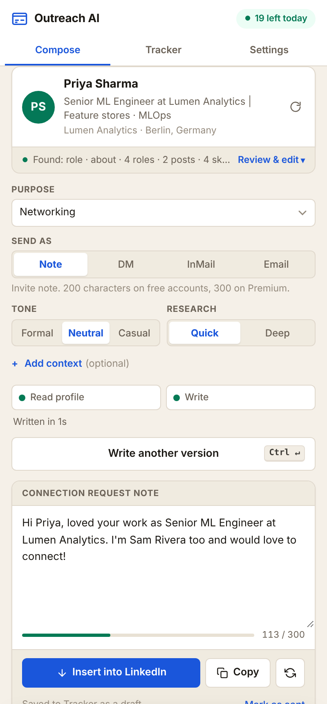
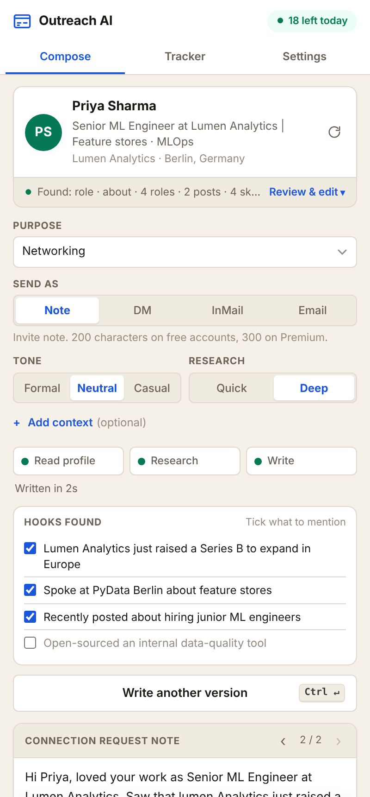
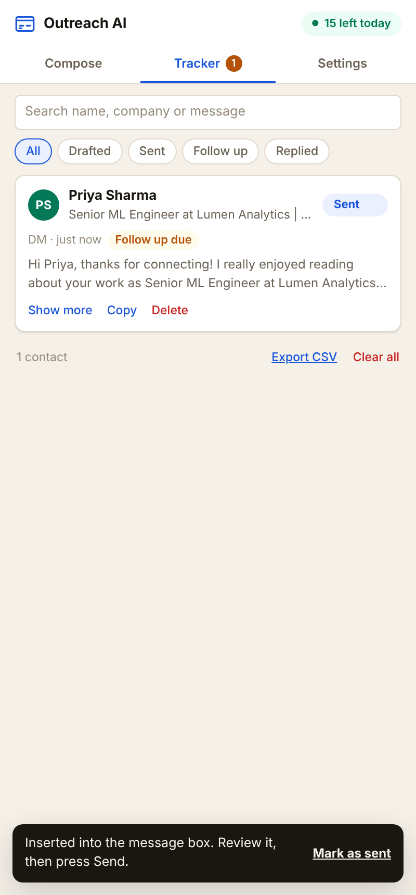

# LinkedIn Outreach AI — v4

Improvements to the Ark Abroad LinkedIn outreach extension. Same product, same server and API, same license keys. It now lives where the work happens, it doesn't lose your work, and it helps you *send* the message, not just write it.

<p>
  
  
  
</p>

## What changed, and why

### 1. It stopped losing work
**Before:** the UI was a popup. Clicking back on LinkedIn closed it, and a ~20-second Deep Mode run vanished along with the result.
**Now:** the background worker runs every job and records progress in `chrome.storage.session`. The UI is just a view of that state. You can close it, switch tabs or browse elsewhere, then come back to a finished message.

### 2. It lives next to LinkedIn
- **Side panel** instead of a popup. It stays open while you browse and **follows you from profile to profile**.
- **Insert into LinkedIn.** One click fills the *Add a note* box of a connection invite, or the message composer (InMail subjects included). It never presses Send; the user always does. If no box is open, it copies the message and says exactly where to click.
- **"Write outreach" button** on profile pages, a right-click menu item, and an `Alt+Shift+O` shortcut.

### 3. Messages that fit where they're going
- **Send as Note / DM / InMail / Email.** Each format has its own rules: invite notes are capped at **200 characters (free) or 300 (Premium)**, and InMail and email get a subject line.
- **Live limit meter**, plus **Trim to fit** (cuts at a sentence boundary) and **Rewrite shorter**.
- **Pick your hooks.** Deep Mode's research results show up as checkboxes. Untick one and rewrite; research doesn't re-run, so no wasted time or credits.
- **Version history.** Every regenerate is kept (‹ 2/3 ›) instead of overwriting the last one.
- **Add context** ("we met at PyCon…") per person, and **Review & edit** what was scraped before generating.
- Purpose, tone, format and mode are remembered.

### 4. A tracker, so outreach gets followed up
Recent contacts grew from 5 to a 50-person tracker:
- status per person (Drafted → Sent → Replied)
- **follow-up reminders** (Chrome notification plus a badge after N days)
- search, filters and **CSV export**

### 5. Reliability and bug fixes
| Bug in v3 | Fix |
|---|---|
| Header said "● Active" for *any* saved key, even a typo | Key is verified against `/api/validate`; the header shows real status and "N left today" |
| Deep Mode never sent your name/bio to the writer | Sent on every request |
| Contacts with an empty `profileUrl` overwrote each other | Keyed by LinkedIn slug, one entry per person |
| `res.json()` on Railway's HTML 502 pages → cryptic JSON error | Safe parse, 1 automatic retry on 5xx/network, plain-English errors (`utils/api.js`) |
| No timeouts, so requests could hang forever | Per-endpoint timeouts |
| Experience parser grouped lines in fixed chunks of 3–4, using an **India-only location regex** to decide where entries ended | Reads LinkedIn's list structure (incl. grouped roles at one company); text fallback anchors on date lines |
| Scraper jumped the page to 2400px and dumped you at the top | Scrolls only if sections are missing, then restores your exact position |
| Dead code and duplicate CSS from older versions | Removed |

### 6. Polish
First-run setup (key → about you → done), dark mode, keyboard shortcuts (`Ctrl+Enter`, `Ctrl+Shift+C`, `Alt+←/→`), toasts with undo-style actions, settings that save automatically, accessible focus states and ARIA roles, reduced-motion support.

## How it's built

```
linkedin extention/
  manifest.json      MV3 · side panel, commands, context menu, alarms, notifications
  background.js      job runner: scrape → research → write; owns all state writes
  content_script.js  scraper, insert-into-LinkedIn, floating button (Shadow DOM)
  sidepanel.html/js/css   UI, a pure view over storage (renders on storage.onChanged)
  utils/
    api.js           server client: timeouts, retries, error classification
    session.js       per-profile working state in chrome.storage.session
    formats.js       Note/DM/InMail/Email rules, the writing brief, meter, trim
    contacts.js      tracker store (migrates v3 "recentContacts" automatically)
```

**No backend changes were needed.** The server's API has no notion of formats, so the requirements travel as a short written brief appended to the sender bio, which the server already gives the model. The request also carries explicit `format`, `maxChars` and `instructions` fields, ready for when the server reads them. Hook selection works by filtering `enrichmentJSON.topHooks` before it goes back to `/api/generate/deep`.

## Install

1. `chrome://extensions` → enable **Developer mode** → **Load unpacked** → choose `linkedin extention/`.
2. Click the toolbar icon (or press `Alt+Shift+O`) to open the side panel and enter your license key.

## Tests

`tests/e2e.js` loads the real extension in Chromium against LinkedIn-like fixture pages (`tests/fixtures/`) and a mock of the Ark API (`tests/mock-server.js`). It covers 52 checks:
- onboarding and key validation
- scraping both page layouts
- quick and deep generation
- LinkedIn swapping pages before the content updates
- closing the panel mid-run
- hook selection
- the 200/300 limits and trimming
- inserting into the invite note and the message box
- tracker, follow-ups and CSV export
- retry after a 502, and auth errors

```bash
node tests/e2e.js            # run (needs Playwright + Chromium)
SHOTS=1 node tests/e2e.js    # also regenerate docs/screenshots/
```
